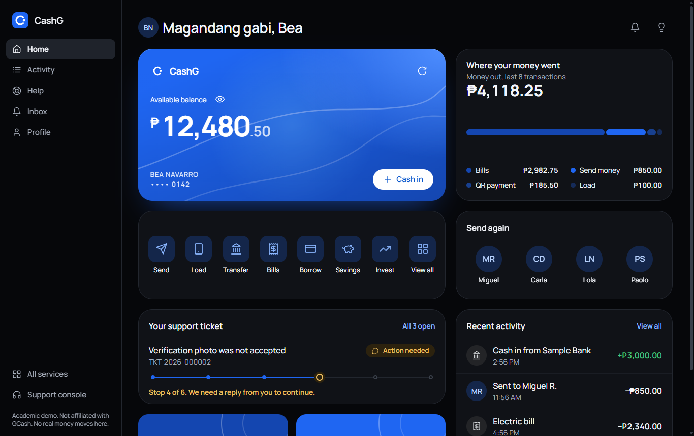
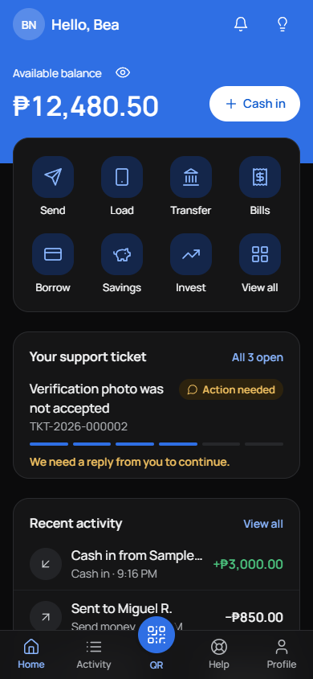
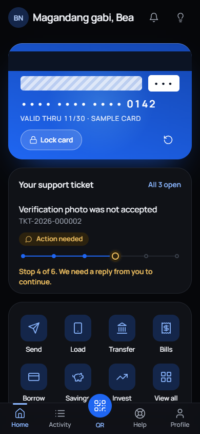
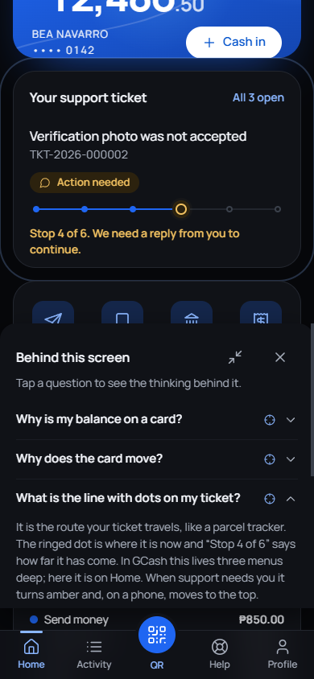
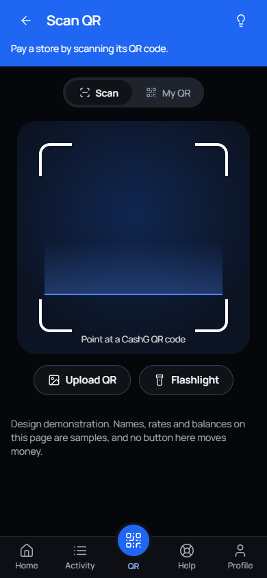
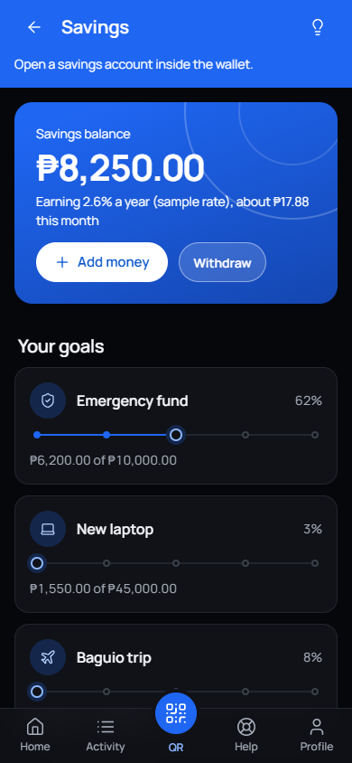
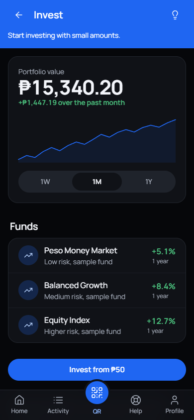
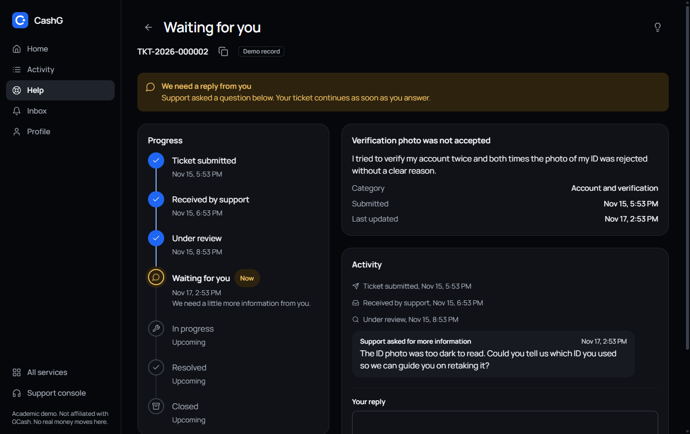
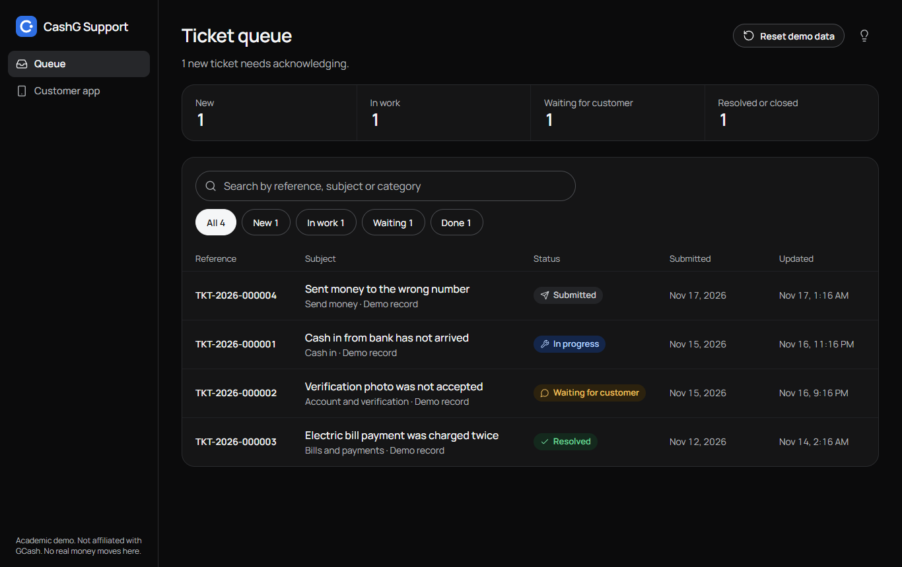
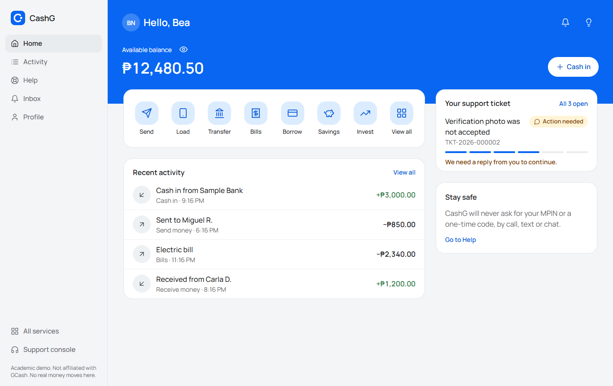

# CashG

**A redesign concept for a GCash-style e-wallet, built around a support ticket you can track like a parcel.**

CashG reimagines a Philippine e-wallet with a bolder, card-first look, and adds the one thing GCash lacks: a support ticket that shows every stage it has passed through, with the time each happened. Built for a university UI/UX course.

> **Academic project. Not affiliated with, endorsed by or connected to GCash.** All names, balances and transactions are sample data, and no real money moves.



---

## Highlights

- **The CashG card.** Your balance lives on a card modelled on the physical CashG card. It tilts toward your mouse (or a finger drag on a phone) and flips over to show its back.
- **A ticket you can follow.** Every support ticket travels a route of stops, from *Submitted* to *Resolved*, each with the real time it happened. Home shows where your ticket is right now.
- **A working support console.** A second view lets staff move tickets through their stages, ask the customer a question and resolve it, all saved in a real database.
- **Every service has a designed page.** Scan QR, Savings, Invest, Bills, Load and the rest look and respond like a real app, and say plainly that nothing was charged or sent.
- **Design notes built in.** Tap the lightbulb on any screen to see the questions behind its design, such as *Why is my balance on a card?*. Opening a question highlights the part of the screen it explains.
- **Responsive and accessible.** One layout system from phone to desktop, light and dark themes, keyboard support, and reduced motion respected.

## Screenshots

### On a phone

<table>
  <tr>
    <td align="center"><br><sub>Home</sub></td>
    <td align="center"><br><sub>The card, flipped</sub></td>
    <td align="center"><br><sub>Design notes</sub></td>
  </tr>
  <tr>
    <td align="center"><br><sub>Scan QR</sub></td>
    <td align="center"><br><sub>Savings goals</sub></td>
    <td align="center"><br><sub>Invest</sub></td>
  </tr>
</table>

### The ticket tracker



### The support console



### Light theme



Every screen is captured at phone and desktop size in both themes in [`docs/screenshots`](docs/screenshots).

---

## What is real and what is a demonstration

| Part | State |
|---|---|
| Support tickets: submit, reference number, My tickets, tracker, messages, support console | **Working**, saved in a database |
| Home, all 14 service pages, Send money, Activity, Inbox, Profile | **Design demonstrations** with sample data; buttons respond but move no money |
| Light, dark and match-device themes; design notes | **Working** |
| Login, real payments, anything connected to GCash | Not included |

## Design approach

The design decisions, and the research and usability principles behind them, are written up in [`docs`](docs):

| Document | What it covers |
|---|---|
| [01 Planning report](docs/01-planning-report.md) | Scope, users and goals |
| [02 Usability test kit](docs/02-usability-test-kit.md) | Tasks and questions for testers |
| [03 GCash research](docs/03-gcash-research.md) | How GCash works today, and where it falls short |
| [04 UX laws applied](docs/04-ux-laws-applied.md) | Each law and heuristic, and where it shows in CashG |
| [05 Implementation](docs/05-implementation.md) | How it is built |
| [06 Evaluation](docs/06-evaluation.md) | Heuristic, accessibility and motion review |
| [07 Recommendations](docs/07-recommendations.md) | What to improve next |
| [How to test CashG](docs/How%20to%20test%20CashG.md) | A guide for test participants |

## Run it

**Testers (Windows):** click **Code → Download ZIP** (or clone), extract it and double-click **`Start CashG.bat`**. Nothing to install: the first start downloads a private copy of Node.js into `app\runtime` (about 36 MB, checksum-verified), and later starts skip it. Then follow [How to test CashG](docs/How%20to%20test%20CashG.md).

The built interface is committed in `app/public`, so after changing anything in `web/`, run `npm run build` and commit `app/public` too.

Other systems need [Node.js](https://nodejs.org) 24 or newer (CashG uses Node's built-in SQLite). First time only:

```bash
cd web
npm install
npm run build
```

Then from the project folder run:

```bash
node app/server.js --open
```

CashG opens at <http://localhost:4173> (or the next free port). It only accepts connections from your own computer.

## Share it with testers

```powershell
powershell -ExecutionPolicy Bypass -File scripts\package.ps1
```

This builds `release\CashG`, a folder with the app, a copy of Node and the test guide. Zip it and share it; testers need nothing installed.

## Work on it

| Command | Run in | What it does |
|---|---|---|
| `node app/server.js` | project folder | Starts the server |
| `npm run dev` | `web` | Live-reloading interface (the server must be running too) |
| `npm run build` | `web` | Builds the interface into `app/public` |
| `node --test app/server.test.js` | project folder | Tests the ticket rules and API |
| `npm test` | `web` | Tests the tracker, money and greeting logic |
| `node scripts/e2e.mjs` | project folder | Drives the real interface in Chrome; add `--show` to watch it |
| `node scripts/break.mjs` | project folder | Fills a throwaway copy with extreme data and checks nothing overflows |
| `node scripts/screenshots.mjs` | project folder | Saves every screen to `docs/screenshots` |

The last three need the server running.

## Project structure

```text
Start CashG.bat            one-click start (Windows)
app/
  server.js                server, database tables and ticket rules
  server.test.js           tests for the above
  config.json              optional Microsoft Clarity project ID
web/src/
  styles.css               design tokens and components
  lib.js                   tracker, money and date logic (tested in lib.test.js)
  demoData.js              sample wallet data and the design notes
  ui.jsx                   shared components: buttons, sheets, the route line
  App.jsx                  app shell, navigation and design notes panel
  pages/                   screens: Wallet, Tickets, Support, ServicePages
docs/                      design write-ups and screenshots
scripts/                   packaging, interface test, worst-case test, screenshots
```

## Good to know

- **Ticket rules live in one place.** Which stage may follow which is the `TRANSITIONS` map near the top of `app/server.js`. The interface reads it from the server, so changing it updates the buttons and the tracker together. Run the tests after any change.
- **Reset the demo.** Open the support console and choose **Reset demo data**, or delete the `app/data` folder while the app is stopped.
- **Optional session recording.** Setting `clarityProjectId` in `app/config.json` turns on Microsoft Clarity. Testers see a notice first, and recording starts only after they agree. The project contains no secrets.

## Known limitations

- No login: there is one preset customer, and the support console is an open link.
- The one-click start is Windows only.
- Changes made in the support console appear in the customer app when a screen is opened or the browser tab regains focus.
- Node's built-in SQLite is still a release candidate.
